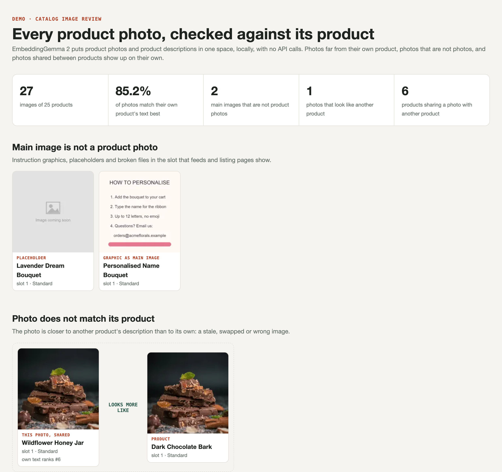
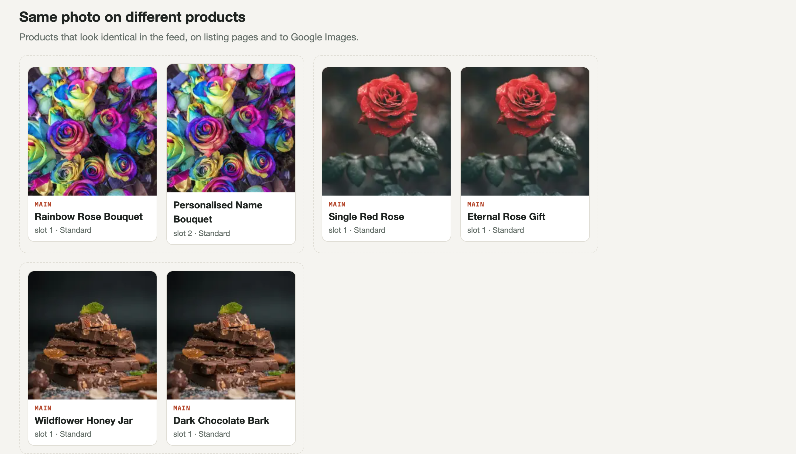

# Catalog Image Index

Every product photo in a catalog, checked against its own product, automatically and locally.

[EmbeddingGemma 2](https://huggingface.co/google/embeddinggemma-2) (Google, open weights, Apache 2.0)
puts product photos and product descriptions in one 768-dimensional space. It runs on a laptop GPU,
with no API calls and no quota, about 0.6 s per image. One set of vectors then does three jobs:

1. **Find main images that are not product photos**: instruction graphics, "coming soon"
   placeholders, broken files, in the slot that shopping feeds and listing pages show.
2. **Find photos that do not match their product**: a photo closer to another product's
   description than to its own is stale, swapped or wrong.
3. **Find the same photo on different products**: products that look identical in the feed and to
   Google Images.

And, as a bonus, **text search** over every photo with no tags or alt text involved.



## Results

On a real gifting catalog (1,629 images of 410 products), checked by eye:

- **Duplicates were the strongest signal**: 291 images on 135 products shared a photo with another
  product, and 33 products had the same *main* photo as a different product.
- **Mismatch flags are a review queue, not errors**: with the composition in the product text, one
  main image was flagged; most secondary flags were bundle components or packaging shots, which the
  report labels as such.
- **The composition matters**: with marketing copy only, 15 correct main images were flagged. The
  prepare step extracts the "Blooms / Components / Inclusions / Ingredients" block, because that is
  what the photo should show.
- Image-text scores tracked Google's paid `gemini-embedding-2` at r = 0.81 on a 40-image baseline:
  good enough for ranking and flagging.



## Quick start

```bash
git clone https://github.com/rodrig0055/catalog-image-index && cd catalog-image-index
uv run prepare.py examples/demo.csv     # 27 demo photos of 25 products -> data/demo/
uv run embed.py demo                    # vectors, on Apple GPU, CUDA or CPU
uv run report.py demo -q "bright yellow flowers" -q "something sweet for a birthday"
open data/report/demo.html
uv run search.py demo "a plant in a white pot"
```

The model downloads from Hugging Face on first run: accept the Gemma licence on the
[model page](https://huggingface.co/google/embeddinggemma-2) and `huggingface-cli login` first, or set
`EG2_MODEL` to a local copy.

The demo catalog has faults planted in it, the kind a real catalog has: a placeholder main image, an
ordering-instructions graphic as a main image, a honey jar showing the chocolate photo, and two pairs
of products sharing one photo. The report finds all of them.


## Your own catalog

A CSV with one row per product image: `product_id, name, variant, slot, image, description[, url]`.
`image` is a URL or a file path, `slot` 1 is the main image, `description` may be HTML. See
[examples/demo.csv](examples/demo.csv).

Outputs in `data/report/`: `<name>_images.csv` (every image with its type, own-text rank and flags),
`<name>_duplicates.csv`, `<name>.html` and `summary.json`. Pass several catalogs (one per market or
brand) to `report.py` and it also lists photos shared across them.

Embedding is resumable (chunks of 256 images), so a 25,000-image catalog can run overnight and pick
up where it stopped.

## Tests

```bash
uv run --group dev pytest -q    # offline: composition extraction and the flags, on hand-made vectors
```

Demo photos are from [Unsplash](https://unsplash.com) and downloaded at run time.

## License

MIT. The model has its own licence (Apache 2.0, plus Gemma terms on Hugging Face).
